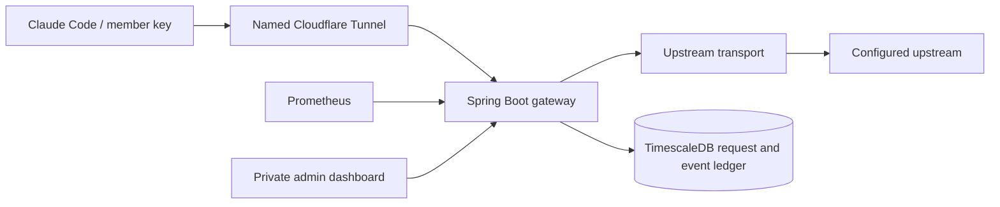

# Subscription Meter

Experimental member-attributed streaming gateway. Java 26, Spring Boot 4.1.2,
TimescaleDB on PostgreSQL 18, and Prometheus. The initial deployment uses a local mock upstream.
**Subscription authentication compatibility has not been established by mock tests.**

## Architecture



TimescaleDB stores request summaries, full details, ordered streaming events, and
access records in four time-partitioned hypertables. Member records remain a
relational table in the same database. Prometheus holds operational metrics, not
the accounting source of truth. Cassandra, Kafka, and Redis are not required for
this single-instance experiment.

The implementation follows SOLID through narrow ports and adapters:

| Responsibility | Port / service | Adapter |
|---|---|---|
| Member keys and revocation | MemberService, MemberRepository | JdbcMemberRepository |
| Admission control | RequestLimiter | InMemoryRequestLimiter |
| Credential provisioning | UpstreamCredentialProvider | FileCredentialProvider |
| HTTP forwarding | UpstreamTransport | JdkUpstreamTransport |
| Streaming usage | UsageObserver | AnthropicUsageObserver |
| Request lifecycle | RequestLedger | JdbcRequestLedger |
| Reporting queries | AnalyticsReader | JdbcAnalyticsReader |
| Request orchestration | GatewayService | Uses the ports above |
| HTTP presentation | GatewayController, AdminController | Servlet response sink |
| Detailed capture | AuditCaptureFactory, AuditStore | JdbcAuditStore |
| Stored-copy redaction | CredentialRedactor | Recursive JSON and text filtering |
| Time partitioning and retention | TimescaleSetup | TimescaleDB policies |

Controllers do not issue database queries or manage upstream credentials.
Request bodies and stream bytes are forwarded without rewriting the protocol.
Usage parsing observes a copy of each chunk. Output-token deltas are cumulative;
the observer does not sum them. Full request and response content is captured in
redacted copies; forwarding is unchanged.

## Build and test

Requires JDK 26 and Maven 3.6.3+:

```sh
mvn package
python3 scripts/bootstrap.py
docker compose up -d --build
python3 scripts/smoke.py
python3 scripts/audit_smoke.py
```

`smoke.py` refuses live mode. It creates 20 members, sends simultaneous streamed
requests, verifies each member's four token counters, then revokes all test keys.
Synthetic records remain visible under `smoke-...` names. Results are written to
`artifacts/smoke.json`. Unit tests cover split streams, accounting, disconnects,
limits, persistence, and errors. Local persistence tests use H2; the acceptance
tests exercise the deployed TimescaleDB database, including full payloads, tool
events, errors, redaction, and authentication boundaries.

## Coder deployment

Directory: `/home/coder/subscription-meter` in `bugpolice-control`.
The Compose project, containers, network, and volumes are independent of BugPolice.

```sh
coder port-forward bugpolice-control --tcp 8180:8180 --tcp 9190:9190
```

Open http://localhost:8180 for the dashboard and http://localhost:9190 for
Prometheus. Only loopback ports are published. Open the admin key file directly
on the workspace (`secrets/admin-token`) and paste it into the dashboard.
The browser holds it in memory, not localStorage. Do not paste it into chat.

Manage the deployment on the workspace:

```sh
cd /home/coder/subscription-meter
sudo docker compose ps
sudo docker compose logs --tail=100 app
sudo docker compose up -d --build
```

Docker restart policies restart processes while the workspace is running; they
do not override Coder template shutdown or inactivity policies. No user autostop
schedule was shown during initial inspection. A workspace shutdown still stops
the service. Persistent volumes are local to this workspace.

## Member access

Create a member through the dashboard; save the displayed key once. Only its
SHA-256 hash and short display prefix are stored in PostgreSQL. The key has 256
bits of random entropy. Revocation blocks new requests; in-flight requests may
finish. RPM and concurrent-request limits apply to each member. There is also
an 80-request global concurrency cap.

Configure a terminal session after a reachable gateway endpoint is available:

```sh
export ANTHROPIC_BASE_URL="https://YOUR_GATEWAY_HOSTNAME"
export ANTHROPIC_AUTH_TOKEN="YOUR_MEMBER_KEY"
unset ANTHROPIC_API_KEY
claude
```

These variables authenticate Claude Code to this gateway. They do not establish
that the upstream subscription path accepts the request. The live experiment
must verify that independently. The prototype supports only `/v1/messages`,
`/v1/messages/count_tokens`, and `/v1/models`; additional Claude Code endpoints
and features may need separate support.

## Subscription experiment

The upstream adapter supports a server-provisioned bearer credential. It reads
only the explicitly configured file and does not search browser sessions,
Keychain, or Claude credential files. It does not implement token refresh.

1. Provision the intended credential directly into `secrets/upstream-token` on
   the workspace using a private terminal/editor. Never commit it or send it in chat.
2. Set `UPSTREAM_MODE=subscription` and `UPSTREAM_URL=https://api.anthropic.com`
   in the workspace's private `.env` file.
3. Recreate the app container: `sudo docker compose up -d --force-recreate app`.
4. Use one member and one small request to validate authentication, streaming,
   and accounting before involving the remaining users.

The adapter forwards client `anthropic-version`, `anthropic-beta`, and user-agent
headers unchanged; it does not invent subscription-specific headers or modify
request payloads. Authentication rejection is a test result, not proof that a
different credential type is required. Credential expiry will surface as an
upstream error. Replace the file and recreate the app after rotation: individual
Docker secret bind mounts may retain the old inode after an atomic file replacement.

## Cloudflare

Use a named tunnel and a domain controlled by you. Quick Tunnels do not support
SSE, so they are unsuitable for the streaming acceptance test. Start from
`deploy/cloudflared.example.yml`. The configuration publishes only the model
routes; admin, dashboard, health, and metrics remain private via Coder forwarding.
Create the DNS route for the hostname and install cloudflared as a supervised
service after the tunnel is configured. No tunnel, DNS record, or external
hostname is created by this repository.

## Accounting limits

- Requests are written as `pending` before the upstream call and finalized once.
  On restart, leftover pending requests become `interrupted`.
- `complete`, `partial`, `disconnected`, `stream_error`, and `upstream_error`
  remain separate in reports. Missing usage is not proof of zero consumption.
- Abrupt process loss can lose the final usage for a pending request. A failed
  final database write leaves the row pending and increments
  `meter_persistence_failures_total`; alert and reconcile these rows.
- Full prompts, response content, tools, and upstream error bodies are stored as
  redacted audit records. They are not sent to ordinary console logs. Authentication
  headers are excluded. Redaction is best effort, not a guarantee that arbitrary
  sensitive content has been removed.
- Observed tokens are neither an exact percentage of a subscription allowance
  nor a bill. No price conversions are made.
- Client retries are separate upstream attempts and are counted separately.
  The gateway does not add an application-level retry policy.
- One application instance only: rate/concurrency limits are in memory and
  reset after restart. Multiple replicas require a shared limiter and a revised
  startup recovery policy. Limits do not impose token budgets on active streams.
- A request has a bounded upstream header wait and a bounded body lifetime,
  each controlled by `UPSTREAM_TIMEOUT_SECONDS` (default 300 seconds).
- Timescale retention defaults to 30 days for details/events/access and 90 days
  for request summaries. Policies drop whole daily chunks, so expiry is approximate.
  No recurring database backup schedule is installed. The migration creates a
  private logical backup and retains the old volume. Prometheus retains 15 days / 2 GB.

## Useful operational metrics

`meter_active_requests`, `meter_requests_total`, `meter_tokens_total`,
`meter_request_duration_seconds_*`, `meter_persistence_failures_total`,
`meter_audit_failures_total`, `meter_audit_truncated_total`, JVM,
HTTP, and connection-pool metrics are available through authenticated
`/actuator/prometheus`. The separate metrics key grants no administration access.

## Full-content request inspector

The dashboard provides paginated requests, a member filter, per-request detail,
ordered event expansion, access records, and JSON export. Admin authentication
protects every inspection endpoint. The private Cloudflare ingress template
continues to expose only model endpoints.

Captured fields include:

- Original request timestamp, member, request ID, model, method/path, sanitized
  query, direct peer address, protocol, and non-authentication client headers.
- Full accepted JSON body: system instructions, messages, code, tool definitions,
  tool results, generation settings, and client metadata, subject to redaction.
- Non-authentication upstream response headers, including rate-limit information.
- Non-streaming response body, including upstream error payloads.
- Streaming event type, sequence, observed time, elapsed time, and redacted data.
  Text, thinking content if the provider sends it, tool calls, input JSON deltas,
  usage, stop events, errors, and comments are retained as events. Raw SSE is not
  stored a second time; this avoids bypassing structured redaction.
- Header wait, first-byte latency (not necessarily first-token latency), total
  duration, original request/response byte counts, captured bytes, and event count.
- Error class/message, completion state, truncation flags, and capture failures.
- Access metadata for rejected or malformed model-route requests. Rejected bodies
  are not captured; the gateway does not read unauthenticated payloads just to log them.

Request and event content remains admin-only. Authentication/cookie/token headers
are dropped. Known key formats, bearer tokens, sensitive JSON fields, and common
secret assignments are redacted in stored copies. This is **best effort**: arbitrary
credentials, encoded secrets, or secrets split across separate semantic events
may evade pattern matching. Treat the full audit store and exports as sensitive.

The inspector records traffic visible to the gateway. It cannot reconstruct
historical bodies that were never recorded, calls made directly to Anthropic,
provider-internal processing, or local tool activity never included in requests.
Old metadata-only rows are explicitly marked in the UI. Every client retry is a
separate request; correlation depends on IDs/metadata actually sent by the client.

Capture limits (forwarding continues when an audit limit is reached):

| Setting | Default |
|---|---:|
| Accepted request body maximum | 16 MiB |
| `AUDIT_MAX_RESPONSE_BYTES` | 8 MiB per request |
| `AUDIT_MAX_EVENTS` | 10,000 per request |
| Maximum individual SSE frame retained | 512 KiB |
| `AUDIT_RETENTION_DAYS` | 30 |
| `AUDIT_METADATA_RETENTION_DAYS` | 90 |

Limits produce an explicit `truncated` capture state and metric. Full request
records are written before forwarding; if that write fails, upstream dispatch
fails closed. Events are written synchronously as they complete. Later audit
write failures increment `meter_audit_failures_total` without replacing the client
response; detail capture is marked `capture_error` when the final write succeeds.
A process crash can lose the current partial event and final timing; startup marks
unfinished records `interrupted`. The extra writes add latency, so reassess write
batching if traffic substantially exceeds this 20-member experiment.

Admin APIs:

- `GET /admin/requests?days=7&memberId=...&limit=25&offset=0`
- `GET /admin/requests/{id}`
- `GET /admin/requests/{id}/events?after=0&limit=100`
- `GET /admin/access?days=7&limit=50&offset=0`

### Upgrade an existing deployment

Build and copy the new application and Compose configuration first. Then run on
the workspace, with Docker access:

```sh
sudo bash scripts/migrate_timescale.sh
```

The migration starts an empty TimescaleDB volume, stops the app, dumps the existing
PostgreSQL database to `backups/`, restores it, checks historical request counts,
and starts the new app. It refuses an already populated target. App startup
converts the audit tables to hypertables and installs retention policies. Check
readiness and run both acceptance scripts before stopping the old `postgres`
service. The old volume and dump are retained; there is no automatic deletion.
If migration fails, investigate before restarting; the backup and old database
remain available. Do not rerun against a partially restored target blindly.

## References

- [Claude Code gateway connection](https://code.claude.com/docs/en/llm-gateway-connect)
- [Anthropic SSE protocol](https://platform.claude.com/docs/en/build-with-claude/streaming)
- [Cloudflare Quick Tunnel limitations](https://developers.cloudflare.com/tunnel/get-started/quick-tunnels/)
- [Spring Boot Java compatibility](https://docs.spring.io/spring-boot/system-requirements.html)
- [Spring Boot metrics](https://docs.spring.io/spring-boot/reference/actuator/metrics.html)

- [TimescaleDB Docker deployment](https://github.com/timescale/timescaledb-docker)
- [Hypertable indexes](https://github.com/timescale/docs/blob/latest/use-timescale/hypertables/hypertables-and-unique-indexes.md)
