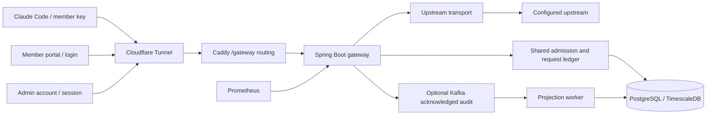

# control-usage

Experimental member-attributed streaming gateway. Java 26, Spring Boot 4.1.2,
TimescaleDB on PostgreSQL 18, Prometheus, and a React + TypeScript frontend. The deployment forwards requests to
Anthropic using the server-provisioned subscription credential. Mock runtime mode
and synthetic production records have been retired. Upstream availability and
successful generation remain subject to the actual provider response.

## Administrator guide and MCP

The dashboard's **Admin guide & MCP** page provides searchable sections and Markdown downloads.
The same source is maintained in the [detailed administrator guide](docs/admin-guide.md)
and [MCP setup/tool reference](docs/mcp-guide.md).

The local TypeScript MCP bridge in `mcp/` provides reporting tools and optional administrative
actions through the existing HTTPS admin APIs. It uses a private, origin-bound, expiring admin
session; sensitive capture access is separately enabled. It issues no member/provider credentials,
performs no inference, and adds no public MCP endpoint. See the MCP guide before enabling actions.

## Architecture



TimescaleDB stores request summaries, full details, ordered streaming events, and
access records in four time-partitioned hypertables. Member records remain a
relational table in the same database. Prometheus holds operational metrics, not
the accounting source of truth. Kafka is an opt-in audit transport with an independent projection worker. Redis
and Cassandra are not needed for this 20-member deployment. Blue and green
application instances share PostgreSQL admission counters, sessions and leases.

The implementation follows SOLID through narrow ports and adapters:

| Responsibility | Port / service | Adapter |
|---|---|---|
| Member keys and revocation | MemberService, MemberRepository | JdbcMemberRepository |
| Admission control | RequestLimiter | PostgresRequestLimiter (in-memory fixture only) |
| Credential provisioning | UpstreamCredentialProvider | FileCredentialProvider |
| HTTP forwarding | UpstreamTransport | JdkUpstreamTransport |
| Streaming usage | UsageObserver | AnthropicUsageObserver, OpenAIUsageObserver |
| Request lifecycle | RequestLedger | JdbcRequestLedger, KafkaRequestLedger |
| Reporting queries | AnalyticsReader | JdbcAnalyticsReader |
| Request orchestration | GatewayService | Uses the ports above |
| HTTP presentation | GatewayController, AdminController | Servlet response sink |
| Detailed capture | AuditCaptureFactory, AuditStore | JdbcAuditStore, KafkaAuditStore |
| Stored-copy redaction | CredentialRedactor | Recursive JSON and text filtering |
| Time partitioning and retention | Serialized migration job | TimescaleDB policies |

Gateway orchestration depends on narrow interfaces; provider credentials remain server-side.
Request bodies and stream bytes are forwarded without rewriting the protocol.
Usage parsing observes a copy of each chunk. Output-token deltas are cumulative;
the observer does not sum them. Accepted request content and bounded response content are captured in redacted
copies. Kafka mode acknowledges each completed response frame before releasing
its original bytes; audit failure or capture-limit exhaustion terminates that
stream. JDBC compatibility mode retains its earlier best-effort response capture.

## Build and test

Requires JDK 26, Maven 3.6.3+, and Node.js 22.13+ with npm. Maven installs the locked frontend dependencies, type-checks and builds both React entries, and runs frontend contract tests:

```sh
mvn package
python3 scripts/bootstrap.py
docker compose up -d timescaledb
python3 scripts/migrate.py --apply --timescale
docker compose up -d --build app
```

The frontend source is in `frontend/src`: separate member and administrator apps
share a typed, same-origin API client. Feature components own display state; API
services own transport and CSRF handling. The production build contains only static
assets inside the Spring Boot jar, so no Node service is needed on Coder. Admin
HTML is packaged outside the public static directory; existing server-side session
and role checks still protect `/manage` and every admin API. Deployment fingerprints
assets by release, including relative module imports, so existing tabs survive a
blue/green switch.

For frontend development, run the Spring app on loopback port 8080, then:

```sh
cd frontend
npm ci --ignore-scripts
npm run dev
```

The dev server proxies `/portal` and `/admin` to that loopback backend. Use only
local test credentials during development. `npm run build` type-checks and creates
`target/frontend-resources`; `npm test` verifies API and packaging contracts after
a build. Production installs use the committed lockfile and include no mock data.

Provision `secrets/upstream-token` before sending model requests. There is no mock
fallback. Unit tests use isolated fixtures and cover split streams, accounting,
disconnects, limits, persistence, authentication, and upstream configuration.
`scripts/metrics_smoke.py URL` checks reporting and static routes without making
model requests; the explicitly invoked `live_smoke.py` performs a bounded real test.

## Coder deployment

Directory: `/home/coder/subscription-meter` in `bugpolice-control`.
The Compose project, containers, network, and volumes are independent of BugPolice.

```sh
coder port-forward bugpolice-control --tcp 8180:8180 --tcp 9190:9190
```

The member portal is available at the Cloudflare HTTPS root URL, and the admin
console is at `/manage`; no port forward is needed for normal use. The optional command above gives local maintenance access
at http://localhost:8180 and Prometheus at http://localhost:9190. Only loopback
ports are published on the workspace, so external access goes through Cloudflare.
Sign in with your administrator account at the root URL; it opens `/manage`.
The `/manage` document is served by the application only after validating an active
admin session. Signed-out or expired sessions redirect to `/`; member accounts get
403. The document is outside the public static directory, and `/manage.html` is not
served. The dashboard renews expired browser access automatically; rejected or revoked refresh logins return to sign-in.
The deployed owner is `vimalkryadav`. The old admin bearer key is disabled whenever
an admin account exists. Account sessions use HttpOnly cookies, not localStorage.

Manage the deployment on the workspace:

```sh
cd /home/coder/subscription-meter
sudo docker compose ps
sudo docker compose logs --tail=100 app
python3 scripts/blue_green.py --help
```

Use the [blue/green deployment procedure](deploy/BLUE_GREEN.md) for upgrades.
The one-time migration from the legacy single app requires an explicitly
authorized admission pause; subsequent releases drain existing streams. Do not
recreate the shared edge, tunnel or database as part of an application release.

Docker restart policies restart processes while the workspace is running; they
do not override Coder template shutdown or inactivity policies. No user autostop
schedule was shown during initial inspection. A workspace shutdown still stops
the service. Persistent volumes are local to this workspace.

## Member accounts and access approval

1. Users open the root URL, choose **Create account**, and register a username,
   name, and password (12–128 characters). Registration signs them in but grants
   no model access. No email provider or subscription credential is needed.
2. In the member dashboard they submit **Request access** with a short reason.
3. The administrator signs in with their username and password, opens `/manage`, and
   approves or rejects the request. Approval sets RPM and concurrency limits.
4. An approved user signs in and clicks **Get my auth token**. The gateway issues
   a personal `ANTHROPIC_AUTH_TOKEN`, displays it once, and shows terminal settings.
5. Users can view their own 30-day usage, sign out, or rotate a lost token.
   Rotation invalidates the old token immediately and preserves member attribution.
   Admin revocation blocks both model access and token rotation; a new request
   and approval are required to restore access. Rejected requests can be resubmitted.

Token requests, decisions, and issuance are serialized per account in database
transactions. Repeated or concurrent claims cannot issue multiple active tokens.
Passwords use salted PBKDF2-HMAC-SHA256 with 600,000 iterations. Browser logins use
opaque 15-minute access tokens and rotating refresh tokens in host-only `Secure`,
`HttpOnly`, `SameSite=Strict` cookies. Access uses `/`; refresh is limited to
`/portal/api`. The browser renews automatically when access expires. Refresh logins
have no server-side idle or absolute expiry; their persistent cookie lasts up to
400 days and is renewed on rotation. Logout or admin session revocation removes the
entire login family. Browser cookie deletion, a changed tunnel hostname or detected
refresh-token reuse can also require a new login. Sign in once after upgrading to
obtain the new refresh cookie. Tokens are never stored in browser web storage.

The database stores bearer hashes and encrypted short retry receipts, not plaintext
bearers. Concurrent refreshes have a 30-second retry window; later reuse of a retained
rotated token revokes its family. Retired token history is retained for 30 days.
CSRF stays stable for each login, and authenticated writes require it. Signup,
login and refresh require a custom request header; cross-site writes are rejected.
Legacy clients, including the private MCP login helper, retain a 12-hour absolute
and one-hour idle session lifetime (up to five legacy sessions per account). The
new browser requests persistent login using `X-Portal-Persistent: 1`.
CORS is not enabled. Password hashing concurrency is bounded per instance; login throttles are shared
in PostgreSQL across application instances. Public portal request bodies are capped at 16 KiB by Caddy.

The portal never accepts a client-supplied account ID for access or usage queries.
Only accounts with the `admin` role can access admin endpoints. Ordinary member
sessions and gateway tokens cannot. Admin writes also require a CSRF token. Passwords,
session secrets, and issued keys are not returned in account or approval listings.
All new tables are additive; existing member keys and captured requests remain.

There is no self-service password reset or email verification in this prototype.
Use HTTPS for the member portal. `PORTAL_SECURE_COOKIE=false` is only for isolated
local HTTP development and tests; the deployment uses secure cookies.

The admin console also retains direct member creation for operator-managed keys.
Only a token's
SHA-256 hash and short display prefix are stored in PostgreSQL. The key has 256
bits of random entropy. Revocation blocks new requests; in-flight requests may
finish. RPM and concurrent-request limits apply to each member. There is also
an 80-request global concurrency cap.

Configure a terminal session after a reachable gateway endpoint is available:

```sh
export ANTHROPIC_BASE_URL="https://YOUR_GATEWAY_HOSTNAME/gateway"
export ANTHROPIC_AUTH_TOKEN="YOUR_MEMBER_KEY"
unset ANTHROPIC_API_KEY
claude
```

These variables authenticate Claude Code to this gateway. They do not establish
that the upstream subscription path accepts the request. The live experiment
must verify that independently. The public gateway supports only `/gateway/v1/messages`,
`/gateway/v1/messages/count_tokens`, and `/gateway/v1/models`; additional Claude Code endpoints
and features may need separate support.

## Subscription experiment

The upstream adapter supports a server-provisioned bearer credential. It reads
only the explicitly configured file and does not search browser sessions,
Keychain, or Claude credential files. It does not implement token refresh.

1. Provision the intended credential directly into `secrets/upstream-token` on
   the workspace using a private terminal/editor. Never commit it or send it in chat.
2. The production Compose service fixes subscription mode and the Anthropic origin.
   Other upstream modes are rejected, including stale `UPSTREAM_MODE=mock` settings
   when starting the Java application outside Compose.
3. Recreate the app container: `sudo docker compose up -d --force-recreate app`.
4. Use one member and one small request to validate authentication, streaming,
   and accounting before involving the remaining users.

The adapter forwards client `anthropic-version`, `anthropic-beta`, and user-agent
headers unchanged; it does not invent subscription-specific headers or modify
request payloads. Authentication rejection is a test result, not proof that a
different credential type is required. Credential expiry will surface as an
upstream error. Replace the file and recreate the app after rotation: individual
Docker secret bind mounts may retain the old inode after an atomic file replacement.

## Cloudflare

The zero-budget deployment uses an **experimental Quick Tunnel** with a randomly
assigned HTTPS `trycloudflare.com` hostname. No Cloudflare account or domain is
needed. The public route is:

```
Cloudflare Quick Tunnel -> 127.0.0.1:8182 (Caddy) -> app:8180
```

`deploy/public-gateway.Caddyfile` separates the dashboard from model requests:

| Public path | Purpose | Authentication |
|---|---|---|
| `/` | Member signup, login, access requests and own usage | Member account session |
| `/manage` | Admin console and approval queue | Admin account session |
| `/assets/*` | Dashboard CSS and JavaScript; no account data | Public |
| `/portal/api/*` | Account, session and personal-token APIs | Session + CSRF for authenticated writes |
| `/admin/*` | Members, analytics, captured requests and events | Admin session + CSRF for writes |
| `POST /gateway/v1/messages` | Streaming and non-streaming model requests | Member key |
| `POST /gateway/v1/messages/count_tokens` | Token counting | Member key |
| `GET /gateway/v1/models` | Model listing | Member key |

Caddy strips `/gateway` before forwarding model requests to the application.
The original public `/v1/*` paths now return 404; update existing clients to use
the `/gateway` base URL. Internal health and Prometheus endpoints return 404 publicly.
Admin sessions cannot be used as member keys, and member keys cannot access admin
data. The same account session is used by the portal and admin console; roles are
checked from the database on every admin request. Sessions and keys do not belong in URLs. Caddy serves the dashboard from the same
source file as the application, mounted read-only.

On `bugpolice-control`, start the dedicated public proxy and tunnel service:

```sh
sudo docker compose --profile public up -d --no-deps public-edge
sudo install -m 0644 deploy/subscription-meter-tunnel.service /etc/systemd/system/
sudo systemctl daemon-reload
sudo systemctl enable --now subscription-meter-tunnel.service
```

The service is specific to this workspace (`coder` user and
`/home/coder/subscription-meter`). It runs the already installed
`/usr/local/bin/cloudflared`, restarts on failure, and leaves other tunnel services
alone. `public-edge` is a separate container with a loopback-only published port.
The Caddy image has a file capability, so its bounding set retains only
`NET_BIND_SERVICE`; other capabilities are dropped and it runs as an unprivileged
user with a read-only root filesystem.

Get the latest hostname or check the connector:

```sh
sudo journalctl -u subscription-meter-tunnel.service -n 150 --no-pager -o cat
curl --fail http://127.0.0.1:20249/ready
```

For operator acceptance scripts, first sign in privately on the workspace:

```sh
python3 scripts/admin_login.py https://YOUR_RANDOM_HOST.trycloudflare.com
```

This prompts for the admin username/password and stores an expiring session in
`secrets/admin-session` with mode 0600. Scripts use that session for admin requests.
The bootstrap bearer key is only accepted before any admin account exists. New
signups always receive the `member` role; no public endpoint allows self-promotion.

Run the read-only dashboard checks on the workspace:

```sh
python3 scripts/metrics_smoke.py https://YOUR_RANDOM_HOST.trycloudflare.com
```

These checks verify protected admin reporting, bounded time windows, aggregate
consistency, and public dashboard assets. The old mock server and scripts that
created synthetic production accounts have been removed. Use `mvn verify` for
isolated regression tests; production checks do not seed sample traffic.

**Observed versus supported behavior:** the initial public test delivered six SSE
events incrementally (first event 0.462 seconds; final event 2.958 seconds) and
completed 20 simultaneous mock streams. Cloudflare nevertheless documents SSE as
unsupported on Quick Tunnels. This experiment is not a guarantee of compatibility
or availability. Quick Tunnels also have a 200 in-flight-request limit, no uptime
guarantee, and a hostname that changes when the tunnel is recreated. After a
restart, retrieve the new URL and update clients' `ANTHROPIC_BASE_URL`.

For a stable, supported deployment later, create a named tunnel under a domain
controlled by you. `deploy/cloudflared.example.yml` routes that named tunnel to
the same restricted public proxy. No domain purchase or named tunnel has been
created by this project.

## Usage, value and subscription accounting

The admin dashboard separates three different measurements:

- **Observed provider quota:** timestamped account-level five-hour/seven-day
  percentages and resets from allowlisted upstream headers or the optional local
  Claude status-line adapter. Missing and stale observations are explicit. Calls
  outside this gateway can consume the same allowance; per-member quota
  percentages cannot be inferred exactly from token counts.
- **Estimated API-equivalent value:** versioned model/component rates applied to
  reported input, output and cache counters. This is a comparison value, not a
  subscription invoice. Missing counters, unknown models and unavailable historic
  rate cards remain partial or unpriced. No missing usage is treated as zero.
- **Subscription expense allocation:** an administrator enters an actual invoice,
  currency, period, attributable gateway fraction and allocation basis. The
  allocation reconciles to the entered amount and exposes unallocated expense.
  It does not claim to reproduce the provider's subscription metering.

Work categories are inferred locally from bounded retained user instructions,
with rule evidence and confidence labels. Administrators can correct them; the
manual category survives later usage/capture updates. These categories describe
request content, not employee productivity or work performed outside the gateway.

Request admission is durable before upstream dispatch. PostgreSQL leases and
shared limits coordinate both application colors; recovery is fenced to a dead
instance. Active, complete, partial, disconnected and upstream-error requests
remain distinguishable. Unknown final usage after process loss remains unknown.
Client retries are separate attempts; the gateway never retries generation.
Limits do not impose token budgets on an already active stream.

Timescale policies retain details/events/access for 30 days and metadata for
90 days by default, dropping whole daily chunks. Prometheus retains 15 days /
2 GB. Kafka durability, projection lag, retention and failure behavior are
described in [the audit pipeline guide](docs/audit-pipeline.md). This is one
workspace with local volumes; blue/green does not provide host/database/tunnel
high availability. Daily private database backups and weekly isolated restore drills are managed by systemd.
See [operations and backup limits](docs/operations.md); these local copies do not protect against workspace or disk loss.

## Useful operational metrics

`meter_active_requests`, `meter_requests_total`, `meter_tokens_total`,
`meter_request_duration_seconds_*`, `meter_persistence_failures_total`,
`meter_audit_failures_total`, `meter_audit_truncated_total`, JVM,
HTTP, and connection-pool metrics are available through authenticated
`/actuator/prometheus`. The separate metrics key grants no administration access.

## Full-content request inspector

The dark-only admin dashboard opens on Metrics with a 24-hour default window, time-window controls,
traffic charts, p50/p95/p99 timings by model, top members/models, errors, and capture
coverage. A custom SVG icon identifies control-usage in both portals and browser tabs.
Activity-window dropdowns use app-styled menus with arrow-key, Home/End, Escape,
type-ahead, and Tab support. Chart values are also available as expandable tables. Activity, member keys,
access requests, and connection settings have separate navigation entries.

The request explorer provides cursor pagination, shareable filter state, member,
model, status, duration, provider, account, key-prefix and category filters,
per-request detail, ordered event expansion, capture completeness and streamed
JSON export. Administration includes account search, session revocation,
conflict-checked RPM/concurrency edits and an audit trail. Role editing is not
exposed; the sole-administrator policy is preserved. Admin authentication
protects every inspection endpoint, including access through the public
Cloudflare URL. Model traffic uses the separate `/gateway` path.

Captured fields include:

- Original request timestamp, member, request ID, model, method/path, sanitized
  query, direct peer address, protocol, and non-authentication client headers.
- Full accepted JSON body: system instructions, messages, code, tool definitions,
  tool results, generation settings, and client metadata, subject to redaction.
- Non-authentication upstream response headers, including rate-limit information.
- Non-streaming response body, including upstream error payloads.
- Streaming event type, sequence, observed time, elapsed time, and redacted data.
  Text, thinking content if the provider sends it, tool calls, input JSON deltas,
  usage, stop events, errors, and comments are retained as events. Raw SSE is not
  stored a second time; this avoids bypassing structured redaction.
- Header wait, first-byte latency (not necessarily first-token latency), total
  duration, original request/response byte counts, captured bytes, and event count.
- Error class/message, completion state, truncation flags, and capture failures.
- Access metadata for rejected or malformed model-route requests. Rejected bodies
  are not captured; the gateway does not read unauthenticated payloads just to log them.

Request and event content remains admin-only. Authentication/cookie/token headers
are dropped. Known key formats, bearer tokens, sensitive JSON fields, and common
secret assignments are redacted in stored copies. This is **best effort**: arbitrary
credentials, encoded secrets, or secrets split across separate semantic events
may evade pattern matching. Treat the full audit store and exports as sensitive.

The inspector records traffic visible to the gateway. It cannot reconstruct
historical bodies that were never recorded, calls made directly to Anthropic,
provider-internal processing, or local tool activity never included in requests.
Old metadata-only rows are explicitly marked in the UI. Every client retry is a
separate request; correlation depends on IDs/metadata actually sent by the client.

Capture limits (Kafka mode stops forwarding at a limit; JDBC mode marks truncation):

| Setting | Default |
|---|---:|
| Accepted request body maximum | 16 MiB |
| `AUDIT_MAX_RESPONSE_BYTES` | 8 MiB per request |
| `AUDIT_MAX_EVENTS` | 10,000 per request |
| Maximum individual SSE frame retained | 512 KiB |
| Detail/event/access retention policy | 30 days |
| Request metadata retention policy | 90 days |

Retention policy changes require a new migration; serving-instance environment
variables do not change existing database policies.

Limits produce an explicit incomplete/truncated capture state and metric. Request
capture must succeed before upstream dispatch. In Kafka mode, acknowledged audit
events precede released response bytes and database projection is asynchronous;
Kafka failure prevents additional unaudited output. In JDBC compatibility mode,
response audit failures are best effort and can leave incomplete capture. See
[the pipeline guide](docs/audit-pipeline.md) for bounds and recovery procedures.

Admin APIs:

- `GET /admin/request-search` provides bounded cursor pagination and filters.
- `GET /admin/request-search/{id}` and `/admin/requests/{id}/export` inspect/export capture.
- `GET /admin/accounting` reports value, category, quota and usage coverage.
- `/admin/accounts`, `/admin/accounts/{id}/sessions`, `/admin/members/{id}/limits`
  and `/admin/action-log` provide administrator operations.

- `GET /admin/metrics?hours=6&mode=all` returns operational summaries, traffic buckets,
  request-duration and first-response-byte percentiles, top members/models, and error counts.
  Windows: `1`, `6`, `24`, or `168` hours; optional modes: `all` or `subscription`.
  Mock-mode queries are rejected.
  Metrics use the request ledger and captured details in one read-only database snapshot.
  Percentiles are calculated from request samples, not averages of bucket percentiles.
  Tokens include input, output, cache creation, and cache reads; missing usage is not
  zero consumption. Metadata-only requests are included only in the all-mode view.
  This endpoint requires the same administrator session as the other admin APIs.
- `GET /admin/requests?days=7&memberId=...&limit=25&offset=0`
- `GET /admin/requests/{id}`
- `GET /admin/requests/{id}/events?after=0&limit=100`
- `GET /admin/access?days=7&limit=50&offset=0`

### Upgrade an existing deployment

Follow [BLUE_GREEN.md](deploy/BLUE_GREEN.md). Schema changes use ordered,
checksummed migrations under a PostgreSQL advisory lock; serving instances do
not create tables or globally rewrite pending rows at startup. Keep the old
image and compatible schema for rollback. The historical PostgreSQL-to-Timescale
script is not the application-release procedure.

### Optional Codex protocol adapter

OpenAI Responses routing exists behind `meter.openai.enabled=false` (the default).
It requires explicit `siwc-plan` authentication and a dedicated server credential
file. It does not reuse the Mac's Codex login, silently fall back to an API key,
or retry generation. Hosted SIWC eligibility, credential provisioning and a real
end-to-end Codex test remain outstanding. Anthropic traffic remains independent.
See [the Codex adapter guide](docs/codex-plan-adapter.md) before enabling this adapter.

## References

- [Claude Code gateway connection](https://code.claude.com/docs/en/llm-gateway-connect)
- [Anthropic SSE protocol](https://platform.claude.com/docs/en/build-with-claude/streaming)
- [Cloudflare Quick Tunnel limitations](https://developers.cloudflare.com/tunnel/get-started/quick-tunnels/)
- [Spring Boot Java compatibility](https://docs.spring.io/spring-boot/system-requirements.html)
- [Spring Boot metrics](https://docs.spring.io/spring-boot/reference/actuator/metrics.html)

- [TimescaleDB Docker deployment](https://github.com/timescale/timescaledb-docker)
- [Hypertable indexes](https://github.com/timescale/docs/blob/latest/use-timescale/hypertables/hypertables-and-unique-indexes.md)

## Bounded live-upstream test

`scripts/live_smoke.py URL --model MODEL_ID` requires a provisioned upstream and
subscription mode. It sends one non-streaming request with at most 32 output
tokens, and only on success sends one streaming request. It checks stored request
attribution, response capture, usage, events, and test-key revocation. It stops on
an upstream error without trying alternate identities or automatic retries.
The script does not change upstream configuration.
Results are private in `artifacts/live-smoke.json`.

The first live attempt returned HTTP 429 (`rate_limit_error`) from Anthropic.
Request/error capture and attribution passed, but real generation and streaming
remain unverified. The deployment now stays in subscription mode and returns real
upstream errors without falling back to synthetic responses.

## Removing the retired mock records

`deploy/remove-mock-data.sql` deletes requests with explicit mock provenance, the
identified pre-capture smoke batch, and recognized inactive fixture keys/accounts.
It preserves real subscription history and administrator accounts, and checks those
invariants before committing. Run it with `psql -v ON_ERROR_STOP=1` only after taking
a private database backup and stopping the app. Unattributed access rejections are
retained because their provenance cannot be established. The deployment directory,
Compose project, and GitHub repository retain their existing `subscription-meter`
identifiers to keep operational resources stable; the platform name is control-usage.

### Persistent member terminal setup

The member portal and admin Connection view provide copyable macOS/Linux/WSL and native Windows PowerShell setup commands with a hidden member-key prompt. The default merges persistent gateway settings into `~/.claude/settings.json`, so users run ordinary `claude` across terminals. A private backup supports undo while preserving later edits. On Windows, the installer uses user/SYSTEM-only file ACLs; it requires Python 3 with the `py` launcher and does not change execution policy. An optional Unix separate profile retains the `claude-work` launcher for users keeping personal and work accounts separate. See [the admin guide](docs/admin-guide.md#one-time-terminal-setup) for rotation, removal and limitations.
