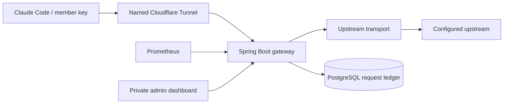

# Subscription Meter

Experimental member-attributed streaming gateway. Java 26, Spring Boot 4.1.2,
PostgreSQL 18, and Prometheus. The initial deployment uses a local mock upstream.
**Subscription authentication compatibility has not been established by mock tests.**

## Architecture



For 20 users, PostgreSQL supports the required member/model/time aggregations
without an additional database engine. Prometheus holds operational metrics,
not the accounting source of truth. TimescaleDB can be added if retention and
time-series volumes justify it. Cassandra, Kafka, and Redis are not required
for this single-instance experiment.

The implementation follows SOLID through narrow ports and adapters:

| Responsibility | Port / service | Adapter |
|---|---|---|
| Member keys and revocation | MemberService, MemberRepository | JdbcMemberRepository |
| Admission control | RequestLimiter | InMemoryRequestLimiter |
| Credential provisioning | UpstreamCredentialProvider | FileCredentialProvider |
| HTTP forwarding | UpstreamTransport | JdkUpstreamTransport |
| Streaming usage | UsageObserver | AnthropicUsageObserver |
| Request lifecycle | RequestLedger | JdbcRequestLedger |
| Reporting queries | AnalyticsReader | JdbcAnalyticsReader |
| Request orchestration | GatewayService | Uses the ports above |
| HTTP presentation | GatewayController, AdminController | Servlet response sink |

Controllers do not issue database queries or manage upstream credentials.
Request bodies and stream bytes are forwarded without rewriting the protocol.
Usage parsing observes a copy of each chunk. Output-token deltas are cumulative;
the observer does not sum them. Prompts and output content are not persisted.

## Build and test

Requires JDK 26 and Maven 3.6.3+:

```sh
mvn package
python3 scripts/bootstrap.py
docker compose up -d --build
python3 scripts/smoke.py
```

`smoke.py` refuses live mode. It creates 20 members, sends simultaneous streamed
requests, verifies each member's four token counters, then revokes all test keys.
Synthetic records remain visible under `smoke-...` names. Results are written to
`artifacts/smoke.json`. Unit tests cover split streams, accounting, disconnects,
limits, persistence, and errors. Local persistence tests use H2; the acceptance
test exercises the deployed PostgreSQL database.

## Coder deployment

Directory: `/home/coder/subscription-meter` in `bugpolice-control`.
The Compose project, containers, network, and volumes are independent of BugPolice.

```sh
coder port-forward bugpolice-control --tcp 8180:8180 --tcp 9190:9190
```

Open http://localhost:8180 for the dashboard and http://localhost:9190 for
Prometheus. Only loopback ports are published. Open the admin key file directly
on the workspace (`secrets/admin-token`) and paste it into the dashboard.
The browser holds it in memory, not localStorage. Do not paste it into chat.

Manage the deployment on the workspace:

```sh
cd /home/coder/subscription-meter
sudo docker compose ps
sudo docker compose logs --tail=100 app
sudo docker compose up -d --build
```

Docker restart policies restart processes while the workspace is running; they
do not override Coder template shutdown or inactivity policies. No user autostop
schedule was shown during initial inspection. A workspace shutdown still stops
the service. Persistent volumes are local to this workspace.

## Member access

Create a member through the dashboard; save the displayed key once. Only its
SHA-256 hash and short display prefix are stored in PostgreSQL. The key has 256
bits of random entropy. Revocation blocks new requests; in-flight requests may
finish. RPM and concurrent-request limits apply to each member. There is also
an 80-request global concurrency cap.

Configure a terminal session after a reachable gateway endpoint is available:

```sh
export ANTHROPIC_BASE_URL="https://YOUR_GATEWAY_HOSTNAME"
export ANTHROPIC_AUTH_TOKEN="YOUR_MEMBER_KEY"
unset ANTHROPIC_API_KEY
claude
```

These variables authenticate Claude Code to this gateway. They do not establish
that the upstream subscription path accepts the request. The live experiment
must verify that independently. The prototype supports only `/v1/messages`,
`/v1/messages/count_tokens`, and `/v1/models`; additional Claude Code endpoints
and features may need separate support.

## Subscription experiment

The upstream adapter supports a server-provisioned bearer credential. It reads
only the explicitly configured file and does not search browser sessions,
Keychain, or Claude credential files. It does not implement token refresh.

1. Provision the intended credential directly into `secrets/upstream-token` on
   the workspace using a private terminal/editor. Never commit it or send it in chat.
2. Set `UPSTREAM_MODE=subscription` and `UPSTREAM_URL=https://api.anthropic.com`
   in the workspace's private `.env` file.
3. Recreate the app container: `sudo docker compose up -d --force-recreate app`.
4. Use one member and one small request to validate authentication, streaming,
   and accounting before involving the remaining users.

The adapter forwards client `anthropic-version`, `anthropic-beta`, and user-agent
headers unchanged; it does not invent subscription-specific headers or modify
request payloads. Authentication rejection is a test result, not proof that a
different credential type is required. Credential expiry will surface as an
upstream error. Replace the file and recreate the app after rotation: individual
Docker secret bind mounts may retain the old inode after an atomic file replacement.

## Cloudflare

Use a named tunnel and a domain controlled by you. Quick Tunnels do not support
SSE, so they are unsuitable for the streaming acceptance test. Start from
`deploy/cloudflared.example.yml`. The configuration publishes only the model
routes; admin, dashboard, health, and metrics remain private via Coder forwarding.
Create the DNS route for the hostname and install cloudflared as a supervised
service after the tunnel is configured. No tunnel, DNS record, or external
hostname is created by this repository.

## Accounting limits

- Requests are written as `pending` before the upstream call and finalized once.
  On restart, leftover pending requests become `interrupted`.
- `complete`, `partial`, `disconnected`, `stream_error`, and `upstream_error`
  remain separate in reports. Missing usage is not proof of zero consumption.
- Abrupt process loss can lose the final usage for a pending request. A failed
  final database write leaves the row pending and increments
  `meter_persistence_failures_total`; alert and reconcile these rows.
- No prompts, responses, credentials, or full upstream error bodies are logged
  or stored. Model names and member names are stored for attribution.
- Observed tokens are neither an exact percentage of a subscription allowance
  nor a bill. No price conversions are made.
- Client retries are separate upstream attempts and are counted separately.
  The gateway does not add an application-level retry policy.
- One application instance only: rate/concurrency limits are in memory and
  reset after restart. Multiple replicas require a shared limiter and a revised
  startup recovery policy. Limits do not impose token budgets on active streams.
- A request has a bounded upstream header wait and a bounded body lifetime,
  each controlled by `UPSTREAM_TIMEOUT_SECONDS` (default 300 seconds).
- No backup schedule or automated retention deletion is installed yet.
  Before retaining real usage, arrange encrypted PostgreSQL backups and choose
  retention. Prometheus retention is 15 days / 2 GB.

## Useful operational metrics

`meter_active_requests`, `meter_requests_total`, `meter_tokens_total`,
`meter_request_duration_seconds_*`, `meter_persistence_failures_total`, JVM,
HTTP, and connection-pool metrics are available through authenticated
`/actuator/prometheus`. The separate metrics key grants no administration access.

## References

- [Claude Code gateway connection](https://code.claude.com/docs/en/llm-gateway-connect)
- [Anthropic SSE protocol](https://platform.claude.com/docs/en/build-with-claude/streaming)
- [Cloudflare Quick Tunnel limitations](https://developers.cloudflare.com/tunnel/get-started/quick-tunnels/)
- [Spring Boot Java compatibility](https://docs.spring.io/spring-boot/system-requirements.html)
- [Spring Boot metrics](https://docs.spring.io/spring-boot/reference/actuator/metrics.html)
